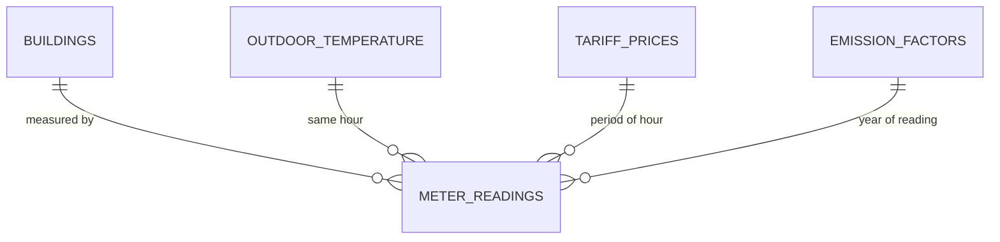

# ⚡ Campus Building Energy Analytics — SQL Project

Hourly smart-meter data for six buildings on a (fictional) Barcelona campus, analysed with SQL.
The queries answer what an energy manager, facilities team or sustainability office needs to know:
where the energy goes, which buildings waste it at night, which days were abnormal, whether a retrofit really worked,
what it costs per tariff period, and how much CO₂ it produces.

> **Skills shown:** time-series SQL · CTEs · window functions (`LAG(…, 12)`, `ROW_NUMBER`, `RANK`, rolling `AVG`/`STDDEV` frames) ·
> named `WINDOW` clauses · z-score anomaly detection · difference-in-differences · statistical aggregates (`REGR_SLOPE`, `REGR_R2`) ·
> views · what-if scenarios. Runs on **PostgreSQL 16** and **DuckDB** with identical results.

---

## The data

| Table | Rows | What it holds |
|---|---:|---|
| `buildings` | 6 | Office tower, laboratory, library, student residence, sports centre, data centre — type, floor area, retrofit date |
| `meter_readings` | 91,872 | Electricity use per building per hour, 1 Jan 2025 – 30 Sep 2026 |
| `outdoor_temperature` | 15,312 | Hourly outdoor temperature |
| `tariff_prices` | 3 | Spanish 2.0TD-style periods P1 (peak) / P2 (shoulder) / P3 (off-peak) |
| `emission_factors` | 2 | Grid kg CO₂e per kWh, per year |

Two views do the heavy lifting: `v_hourly` adds the tariff period, day type and temperature to every reading, and `v_daily`
rolls it up per building per day with cooling and heating degree-days.

The data is synthetic and reproducible (`scripts/generate_data.py`, fixed seed). It follows realistic patterns — working hours,
weekends, an August holiday shutdown, heating and cooling with the weather — and hides things for the queries to find:
**six abnormal events** (equipment left running over a weekend, a night-time spike, a summer evening fault…) and **an energy-efficiency retrofit**
in the laboratory in January 2026. Prices and emission factors are illustrative.



---

## Business questions answered

| # | Question | Key SQL techniques |
|---|---|---|
| [Q1](queries/01_monthly_consumption_yoy.sql) | Monthly use per building and per m², vs. the same month last year | `DATE_TRUNC`, `LAG(…, 12)` with a named `WINDOW` |
| [Q2](queries/02_monthly_peak_demand.sql) | When does each building hit its monthly peak demand? | `ROW_NUMBER()` top-1 per group |
| [Q3](queries/03_night_baseload.sql) | Which buildings waste energy at night? | Conditional averages, ratio KPI, `CASE` rules per building type |
| [Q4](queries/04_anomaly_detection.sql) | Which days were abnormal — and is there an innocent explanation? | Rolling `AVG`/`STDDEV` excluding the current row, z-score, triage `CASE` |
| [Q5](queries/05_retrofit_impact.sql) | Did the lab retrofit actually save energy? | Difference-in-differences against control buildings |
| [Q6](queries/06_tariff_cost_and_load_shift.sql) | Cost per tariff period, and the saving from shifting 10% of peak use | Pivot with conditional `SUM`, `SUM() OVER` share, what-if |
| [Q7](queries/07_emissions_by_building.sql) | CO₂ per building per year, and the most carbon-intensive per m² | Join to yearly factors, `RANK()` |
| [Q8](queries/08_weather_sensitivity.sql) | How much extra energy per hot / cold degree-day? | `REGR_SLOPE`, `REGR_R2` on filtered data |

Full outputs for every query are in [`results/`](results).

---

## Highlights

**The retrofit worked — and here is the proof (Q5).** Comparing Lab B before and after its January 2026 retrofit isn't enough,
because weather and occupancy change too. So the query compares the same months (Feb–Sep) in 2025 and 2026, for Lab B and for the
four buildings that weren't touched (the control group), and subtracts one change from the other:

| Lab B change | Control buildings change | Retrofit effect | kWh saved (Feb–Sep 2026) |
|---:|---:|---:|---:|
| −20.2% | −0.1% | **−20.1%** | **363,287** |

**Anomaly detection with triage (Q4).** Each day is compared with the building's previous 20 days of the same type
(weekday vs. weekend). Days more than 3 standard deviations *and* 25% above normal are flagged — 20 in total. Instead of handing
the facilities team 20 alarms, the query explains them first:

| Triage | Days |
|---|---:|
| Investigate — no weather or calendar explanation | 7 |
| Hotter than recent days — check cooling schedule | 7 |
| Back from August shutdown — expected | 6 |

The 7 "investigate" days correspond to four of the hidden faults (Torre A weekend HVAC in March, Lab B in June,
a night-time spike in the residence in November, the sports centre in February). A fifth sits under the heat flag. The one it
misses happened *during* the August shutdown, when the baseline itself is unusual — a known limitation of rolling baselines.

**Night-time waste (Q3).** Lab B keeps using **51% of its daytime load at night** (214 kW vs 416 kW) — flagged *Investigate*.
The residence and data centre are high too, but that's expected, so the rules take building type into account.

**Where the money goes (Q6).** Over the last 12 months Lab B is the most expensive building (€346k, 23% of the campus bill).
Shifting just 10% of peak-hour use to off-peak would save **≈ €35k per year across the campus**, most of it in Torre A and Lab B.

**Carbon intensity (Q7).** The data centre is by far the most carbon-intensive building per m² (228 kg CO₂e/m² in 2025 —
4× the lab), even though the lab uses more energy in total.

**Weather sensitivity (Q8).** On weekdays, Torre A uses **332 kWh more per cooling degree-day** (R² 0.94) and 244 more per
heating degree-day — the best candidate for HVAC optimisation. The data centre barely reacts to the cold (cooling load only).
Lab B's low R² is itself a finding: its consumption is driven by equipment and by the retrofit, not by the weather.

---

## How to run

**Option A — DuckDB (no database server needed)**
```bash
pip install duckdb
python scripts/run_all.py          # builds the DB in memory, runs every query, writes results/*.md
```

**Option B — PostgreSQL**
```bash
createdb energy
psql -d energy -f sql/01_schema.sql -f sql/02_load_postgres.sql -f sql/03_views.sql
psql -d energy -f queries/05_retrofit_impact.sql
```

To regenerate the sample data: `python scripts/generate_data.py`.

## Repository structure

```
sql/        01_schema.sql · 02_load_duckdb.sql · 02_load_postgres.sql · 03_views.sql
queries/    01 … 08 — one business question per file, commented
data/       CSV sample data (synthetic)
results/    query outputs as Markdown tables
scripts/    generate_data.py · run_all.py
```

---

*Author: **Valentina Simao** — Industrial Engineer & Data Analyst, Barcelona ·
[LinkedIn](https://www.linkedin.com/in/valentina-s-b79264150)*
*All buildings and readings are fictional; prices and emission factors are illustrative.*
